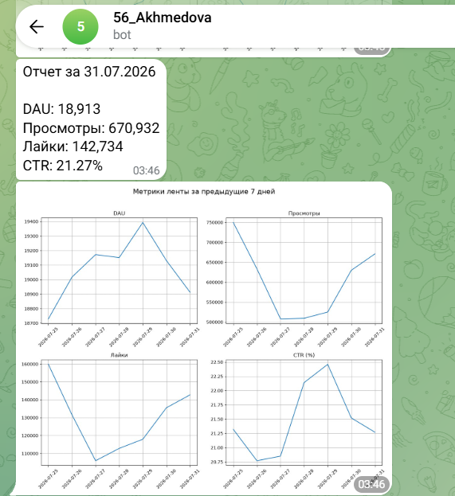

# Автоматизация отчётности по ленте новостей

*Ежедневная сводка в Telegram с продуктовыми метриками за предыдущий день и их динамикой за неделю.*

## Задача

Автоматизировать подготовку отчёта по активности пользователей ленты новостей. Вместо ручного расчёта показателей получать каждый день текстовую сводку и графики в Telegram.

## Как устроен отчёт

Из таблицы `feed_actions` в ClickHouse рассчитываются четыре метрики:

| Метрика | Что показывает |
|---|---|
| DAU | Количество уникальных пользователей ленты за день |
| Просмотры | Количество событий `view` |
| Лайки | Количество событий `like` |
| CTR | Отношение лайков к просмотрам, в процентах |

DAG `sevil_feed_report` настроен на ежедневный запуск в Apache Airflow в 11:00. Он получает показатели за предыдущий календарный день и динамику за семь дней, формирует сообщение, строит четыре линейных графика и отправляет их через Telegram-бота.

**Инструменты:** Python, SQL, ClickHouse, pandas, seaborn, matplotlib, Apache Airflow, pyTelegramBotAPI (`telebot`).

[Посмотреть код DAG](dags/feed_report.py)

## Результат

В исходной работе Telegram-бот отправлял сообщение с метриками и графиками. Ниже сохранившийся пример отчёта за **31 июля 2026 года**:

| Показатель | Значение |
|---|---:|
| DAU | 18 913 |
| Просмотры | 670 932 |
| Лайки | 142 734 |
| CTR | 21,27% |

## Запуск и ограничения

Для запуска необходимы Apache Airflow 2.x, ClickHouse с исходной таблицей `feed_actions` и Python-библиотеки, использованные в DAG. Подключение к ClickHouse и настройки бота задаются через переменные окружения `CLICKHOUSE_HOST`, `CLICKHOUSE_READ_USER`, `CLICKHOUSE_READ_PASSWORD`, `TELEGRAM_BOT_TOKEN` и `TELEGRAM_CHAT_ID`.

Проект выполнен в рамках обучения в Karpov.Courses. Исходная база сейчас недоступна. Скриншот подтверждает отправку отчёта ботом, но не позволяет проверить историю запусков Airflow по расписанию. После подготовки к публикации версия с переменными окружения и выбором дат через контекст Airflow повторно не запускалась в учебной среде.
