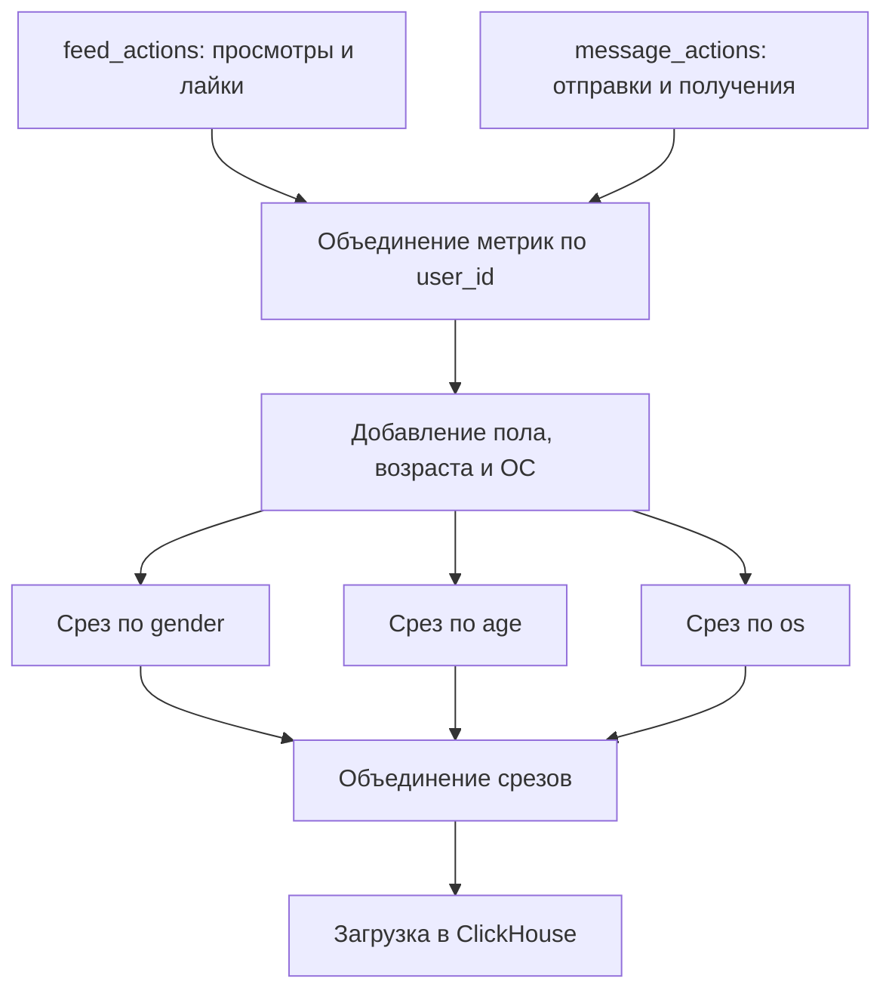

# ETL продуктовых метрик на Airflow

*Ежедневная обработка событий ленты новостей и мессенджера с формированием срезов для аналитической отчётности.*

## Задача

Автоматизировать расчёт продуктовых метрик за предыдущий день и сохранять результаты в ClickHouse. Итоговая таблица позволяет сравнивать активность пользователей по полу, возрасту и операционной системе без повторного расчёта показателей из сырых событий.

## Как устроен процесс

Процесс реализован в DAG `sevil_ahmedova_etl` с ежедневным запуском в Apache Airflow. Отдельные задачи рассчитывают метрики ленты и сообщений, объединяют данные по пользователям и формируют три среза.

| Метрика | Что показывает |
|---|---|
| `views` | Количество просмотров в ленте |
| `likes` | Количество лайков |
| `messages_sent` | Количество отправленных сообщений |
| `messages_received` | Количество полученных сообщений |
| `users_sent` | Сумма числа уникальных получателей сообщений каждого пользователя |
| `users_received` | Сумма числа уникальных отправителей сообщений каждому пользователю |

В двух последних метриках уникальные собеседники сначала считаются для каждого пользователя, а затем суммируются внутри среза. Поэтому это не число уникальных пользователей всего сегмента.

**Инструменты:** Python, pandas, SQL, ClickHouse, pandahouse, Apache Airflow.

[Посмотреть код DAG](dags/user_metrics_etl.py)

## Результат

В учебной среде первоначальная версия DAG создавала и заполняла таблицу `test.sevil_table`. Для каждой даты в ней сохранялись показатели по полу, возрасту и операционной системе.

В сохранившейся выгрузке содержатся **1 608 строк за 23 дня** (22 июля - 14 августа 2026 года). Повторяющихся сочетаний `event_date`, `dimension` и `dimension_value` не обнаружено.

## Запуск и ограничения

Для запуска необходимы Apache Airflow 2.x, библиотеки `pandas` и `pandahouse`, а также доступ к исходным таблицам ClickHouse. Параметры подключения задаются через переменные окружения.

Проект выполнен в рамках обучения в Karpov.Courses. Исходная учебная база сейчас недоступна, поэтому после исправления расчёта `users_received` обновлённая версия DAG не запускалась повторно на исходных данных.
