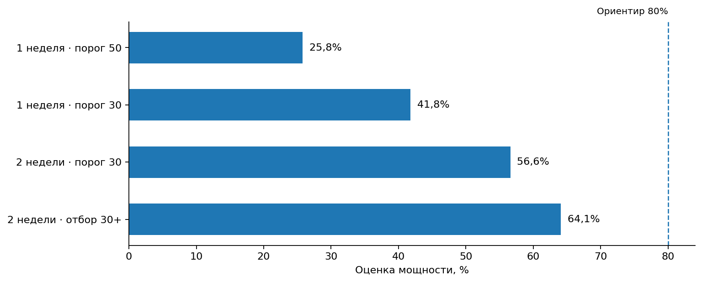

# Оценка мощности A/B-теста рекомендательного алгоритма

**Python · NumPy · SciPy · ClickHouse · Монте-Карло**

## Задача

Перед запуском нового рекомендательного алгоритма нужно было понять, хватит ли пользователей, чтобы обнаружить изменение среднего количества лайков.

По условиям алгоритм добавляет **1 или 2 просмотра с вероятностью 90%**, но срабатывает только для пользователей, достигших определённого числа просмотров. Предполагается, что дополнительные просмотры могут привести к увеличению числа лайков.

Для оценки мощности A/B-теста проведены симуляции Монте-Карло. Они позволяют оценить, как часто статистический тест обнаружит **предполагаемый эффект** при разных настройках эксперимента. Это не результаты реального запуска нового алгоритма.

## Как проводилось моделирование

На основе событий ленты в ClickHouse были построены частотные распределения просмотров и CTR. Для исходного распределения использовались данные **22–28 мая 2026 года**.

В каждой симуляции:

1. Формировались контрольная и тестовая группы. Число просмотров и CTR генерировались из исторических распределений с помощью `numpy.random.Generator.choice()`.
2. Для тестовой группы моделировалось действие алгоритма: пользователи, достигшие порога просмотров, с вероятностью 90% получали ещё 1 или 2 просмотра.
3. Количество лайков для каждого пользователя рассчитывалось с помощью биномиального распределения на основе числа просмотров и CTR.
4. Среднее число лайков на пользователя сравнивалось между группами с помощью **t-теста Уэлча** (`equal_var=False`).

Для каждого сценария использовалось **20 000 симуляций**, соотношение групп **50/50** и уровень значимости **5%**. Мощность рассчитывалась как доля симуляций, в которых `p-value < 0.05`.

## Как менялись условия эксперимента

Сначала рассматривался недельный эксперимент с исходным алгоритмом. Затем последовательно изменялись условия, чтобы проверить, можно ли повысить мощность теста.

| Сценарий | Что изменилось | Оценка мощности |
|---|---|---:|
| **1. Исходный вариант** | 1 неделя, алгоритм срабатывает от **50 просмотров**, в анализ входят все пользователи | **25,8%** |
| **2. Снижение порога** | Алгоритм срабатывает от **30 просмотров**, остальные условия прежние | **41,8%** |
| **3. Увеличение длительности** | Эксперимент длится **2 недели**, размер групп увеличивается, порог остаётся 30 просмотров | **56,6%** |
| **4. Анализ целевой аудитории** | В статистический тест включаются только пользователи с **30 и более просмотрами**, остальные условия как в третьем сценарии | **64,1%** |

### Что повлияло на результат

**Снижение порога с 50 до 30 просмотров** позволило алгоритму затронуть больше пользователей. Оценка мощности выросла с 25,8% до 41,8%.

**Увеличение срока эксперимента до двух недель** повысило число пользователей в группах. В исходном сценарии моделировалось **20 998 пользователей на группу**, в двухнедельном **30 591 пользователь**. При этом исторические распределения просмотров и CTR не менялись, как было предусмотрено условиями исследования. Оценка мощности достигла 56,6%.

**Отбор пользователей с 30 и более просмотрами** дополнительно повысил мощность до 64,1%. Для этой группы алгоритм потенциально мог повлиять на поведение, тогда как пользователи ниже порога не получали дополнительных просмотров. В последнем сценарии отбор выполнялся по исходному числу просмотров, до моделирования эффекта алгоритма.

## Вывод

Изменение условий эксперимента повысило оценку мощности с **25,8% до 64,1%**. Наибольший результат получился при двухнедельном тесте с анализом пользователей, на которых алгоритм должен влиять.

Однако **64,1% всё ещё ниже распространённого ориентира 80%**. В таких условиях эксперимент может не обнаружить даже реально существующий эффект заданного размера.

Перед запуском стоит дополнительно оценить необходимое число пользователей и продолжительность теста. **MDE отдельно не рассчитывался**: в этой работе сравнивалась мощность при заданной модели эффекта.

## Код и сохранённые результаты

- [Сценарий 1: исходные условия, мощность 25,8%](notebooks/power-baseline.ipynb)
- [Сценарий 4: две недели и целевая аудитория, мощность 64,1%](notebooks/power-targeted.ipynb)

Для первого и четвёртого сценариев сохранились ноутбуки с кодом и результатами выполнения. Для промежуточных **41,8%** и **56,6%** сохранились ответы к заданиям, но отдельный исполняемый код этих двух запусков недоступен. Все четыре значения представлены на графике как результаты исходного исследования, а не повторного пересчёта.

## Что важно учитывать

В исходных SQL-запросах **просмотры считались за неделю на пользователя**, а **CTR за каждый день на пользователя**. Затем значения из этих распределений выбирались независимо. Поэтому модель не полностью сохраняет связь между активностью пользователя и его CTR. Это может влиять на оценку мощности; для планирования реального эксперимента желательно согласовать период агрегации и проверить расчёты на исходных данных.

Исходная база ClickHouse сейчас недоступна. Код публичных ноутбуков сохранён без паролей, а результаты оставлены из первоначальных запусков. Повторно расчёты не выполнялись. В первоначальных симуляциях также не был зафиксирован `seed`, поэтому точные проценты при повторном запуске могут немного отличаться.

**Источник данных и постановки задачи:** Karpov.Courses, «Симулятор аналитика».
