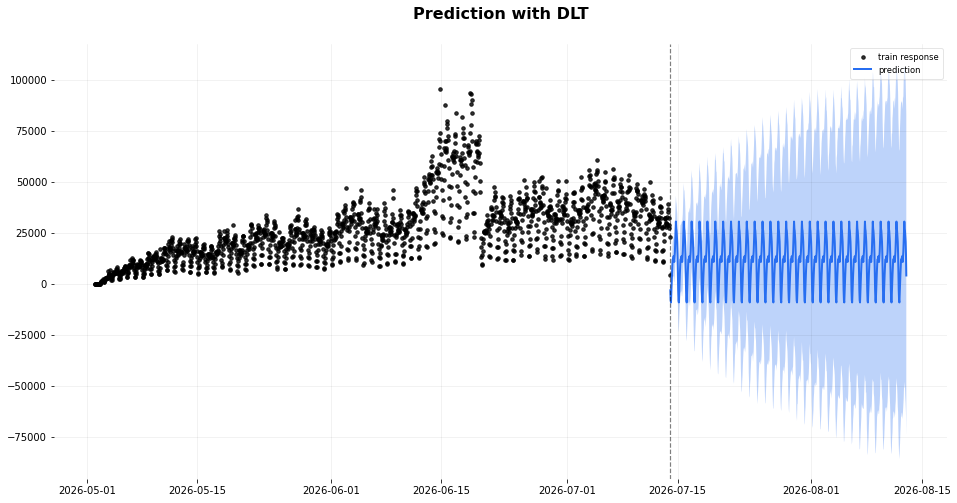
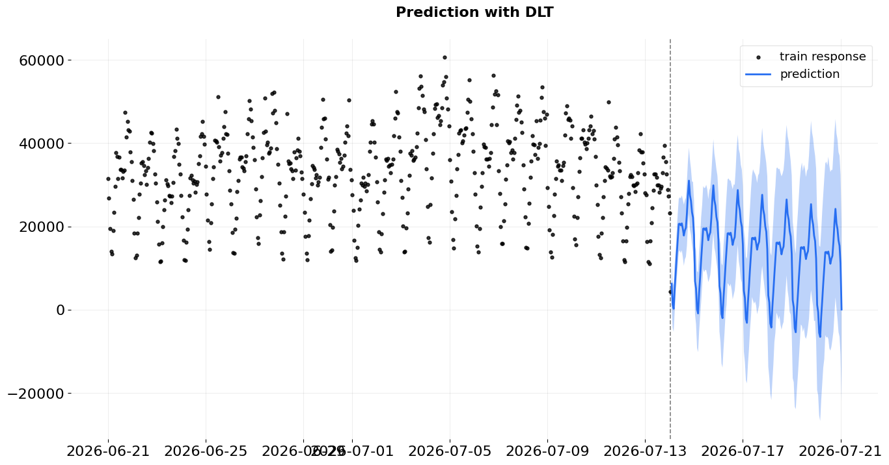
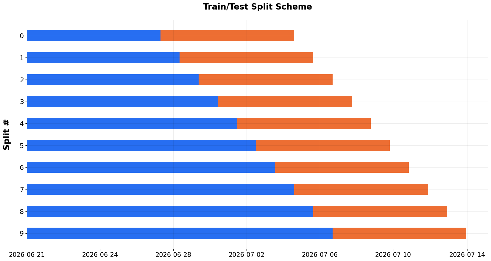

# Прогнозирование активности пользователей

*Python · SQL · ClickHouse · Orbit · Бэктестирование*

## Задача

Активность пользователей влияет на нагрузку на серверы приложения. Для планирования ресурсов нужно понять, сколько действий в ленте новостей можно ожидать в ближайшее время и насколько точным будет такой прогноз.

Для анализа выбрано **количество действий в ленте за час**: просмотров (`view`) и лайков (`like`). Почасовой ряд позволяет увидеть суточные колебания активности и периоды наиболее высокой нагрузки. При этом число событий используется как приближённый показатель нагрузки, а не как её прямое измерение.

## Кратко о результатах

| Этап | Результат |
|---|---|
| Прогноз на 30 дней по всей истории | Сильная неопределённость и отрицательные прогнозные значения. Для планирования нагрузки такой прогноз использовать нельзя |
| Прогноз на 7 дней по данным с 21 июня | Колебания стали стабильнее, но неопределённость сохраняется |
| Бэктест на 7 дней | sMAPE **19,69%**, WMAPE **19,02%**, MAPE **20,85%**, RMSSE **1,82** |
| Подбор параметров | Среди проверенных значений `damped_factor` минимальную ошибку дал вариант **0,3** |

**Основной вывод:** имеющихся данных недостаточно для уверенного прогноза на месяц. На горизонте недели модель можно оценить с помощью бэктеста, но её точность пока недостаточна, чтобы считать прогноз надёжным для планирования серверных ресурсов.

## 1. Подготовка данных

События из таблицы `feed_actions` сгруппированы по часам с помощью ClickHouse. В каждом интервале подсчитывается общее количество просмотров и лайков.

Для прогноза использована модель **DLT (Damped Local Trend)** из библиотеки Orbit с суточной сезонностью (`seasonality=24`) и оценкой параметров `stan-map`. Дополнительные регрессоры в модель не включались.

## 2. Первоначальный прогноз на 30 дней

Сначала модель обучалась на всей доступной истории. Однако временной ряд содержит резкие изменения активности, в том числе в период рекламных мероприятий и около 20 июня, когда наблюдалось сильное падение продуктовых метрик.

В результате долгосрочный прогноз оказался нестабильным. Прогнозные интервалы расширялись, а отдельные значения уходили ниже нуля, что не имеет смысла для количества действий.

**Вывод:** строить прогноз на месяц по этому ряду без дополнительной обработки и проверки качества нецелесообразно.

## 3. Прогноз после изменения периода обучения

Для следующего варианта оставлены данные **начиная с 21 июня 2026 года**, после наиболее заметных изменений активности. Горизонт прогнозирования сокращён до семи дней.

На этом участке прогноз выглядит стабильнее. При этом нижняя граница прогнозного интервала всё ещё местами отрицательна, а объём обучающей истории стал значительно меньше. Исключение более раннего периода помогает сосредоточиться на относительно устойчивых данных, но не гарантирует качество прогноза в будущие периоды.

## 4. Проверка качества прогноза

Для оценки точности использован **бэктест с расширяющимся окном (expanding window)**. В сохранённом расчёте заданы:

- начальный период обучения: **14 дней**;
- горизонт прогноза: **7 дней**;
- шаг перехода между проверками: **24 часа**.

Результаты сохранённого запуска:

| Метрика | Значение |
|---|---:|
| sMAPE | 19,69% |
| WMAPE | 19,02% |
| MAPE | 20,85% |
| RMSSE | 1,82 |

Значение RMSSE выше 1 указывает, что ошибка модели превышает масштаб ошибки наивного прогноза, используемый для нормировки метрики. Это повод дополнительно проверить модель, но не замена прямому сравнению с наивным прогнозом на тех же тестовых периодах.

Отдельно была подготовлена схема суточного бэктеста с начальным обучением на семи днях, но численный результат его выполнения **не сохранился**. Поэтому сравнительные показатели ошибки для горизонта 24 часа здесь не приводятся.

## 5. Подбор параметров модели

С помощью `grid_search_orbit` проверены значения `damped_factor` от 0,1 до 0,9. Лучшее значение по использованному критерию подбора на данном участке данных: **0,3**. Значение целевой ошибки в сохранённом выводе составило около **0,1816**.

Этот результат относится только к выбранному временному ряду и схеме бэктестирования. Он не доказывает, что такое значение параметра будет оптимальным на других данных.

## Выводы

- Для планирования нагрузки важно прогнозировать не только общий уровень активности, но и её изменение по часам.
- Резкие изменения временного ряда усложняют прогнозирование. После исключения наиболее нестабильного периода модель стала вести себя предсказуемее, но история наблюдений сократилась.
- На семидневном горизонте ошибка остаётся заметной. Также стоит отдельно проверить, может ли модель обойти простой наивный прогноз на одинаковых тестовых периодах.
- Для более надёжного решения нужны дополнительные наблюдения, сравнение с простыми базовыми моделями и, возможно, признаки маркетинговых активностей и технических событий.

## Код и данные

[Открыть ноутбук с прогнозированием и бэктестом](notebooks/feed-activity-forecast.ipynb)

Анализ выполнен на данных приложения из Karpov.Courses «Симулятор аналитика». Доступ к исходному ClickHouse сейчас закрыт. В ноутбуке сохранены результаты первоначальных расчётов и графики, но повторный запуск требует доступа к исходным данным. Параметры подключения вынесены в переменные окружения.

В исходном ряду последний календарный день представлен не полностью. Это дополнительное ограничение, которое стоит учитывать при подготовке новой версии модели. Оригинальные результаты после изменения кода подключения не пересчитывались.
