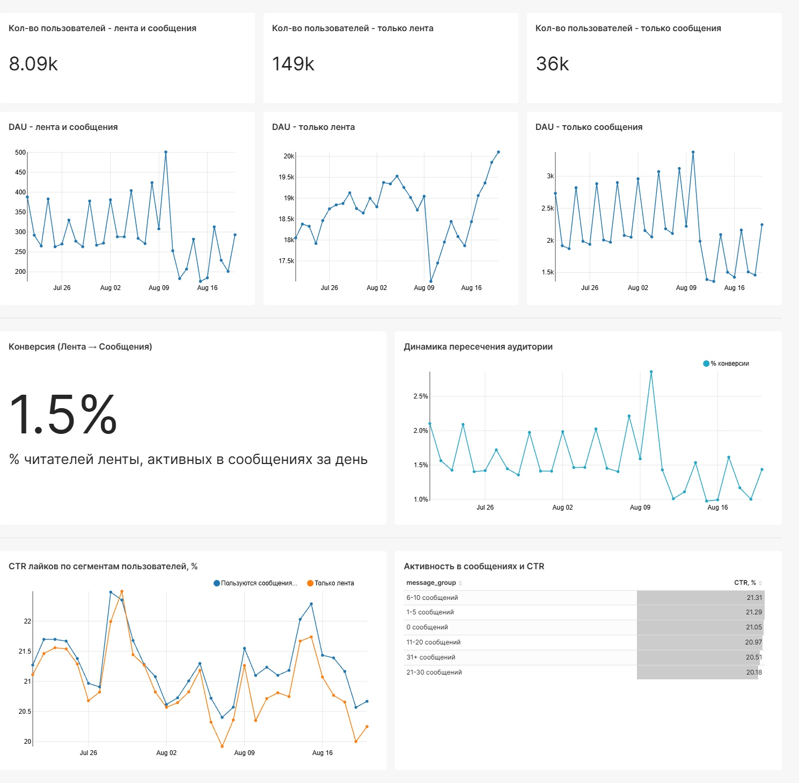
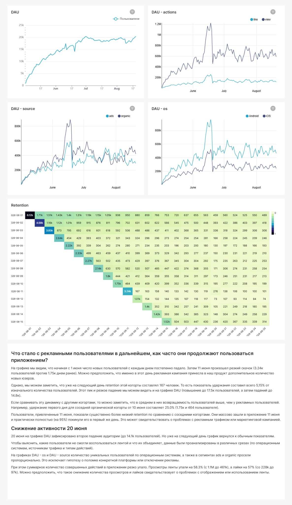
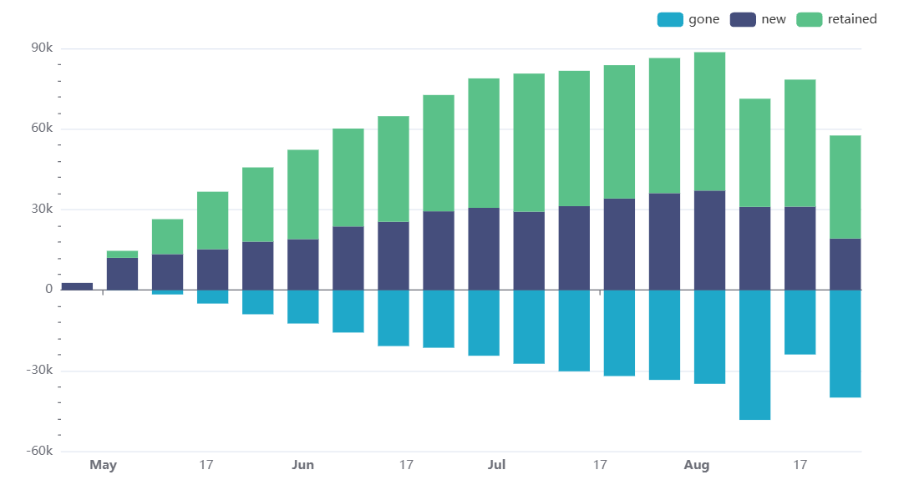

# Продуктовые метрики и удержание пользователей

**SQL · ClickHouse · Apache Superset**

В этом блоке я анализировала активность пользователей приложения с лентой новостей и мессенджером. Хотелось понять, насколько пересекаются аудитории двух сервисов, возвращаются ли пользователи после рекламной кампании и с чем могло быть связано резкое падение активности.

## Коротко о результатах

| Что исследовала | Что удалось выяснить |
|---|---|
| Лента и сообщения | Ежедневное пересечение аудиторий составило около **1,5%** |
| Рекламная аудитория | У когорты **11 июня** на следующий день вернулись **5,15%** пользователей, тогда как у когорты 10 июня около **26,5%** |
| Падение активности | **20 июня** DAU снизился примерно до **14,1 тыс.**, просмотры упали на **58,3%**, лайки на **57%** |

## 1. Как пользователи взаимодействуют с лентой и мессенджером

Сначала я сделала дашборд, который помогает сравнить аудитории двух частей приложения. Разделила пользователей на три группы: те, кто пользуется и лентой, и сообщениями, только лентой или только сообщениями.

На момент выгрузки дашборда получилось около **8,09 тыс.** пользователей обоих сервисов, **149 тыс.** пользователей только ленты и **36 тыс.** только сообщений. Также я сравнила DAU этих групп, динамику пересечения аудитории и CTR лайков.

**Вывод.** Пересечение аудиторий на уровне ежедневной активности было небольшим, около 1,5%. То есть пользователи не так часто проявляли активность в обоих сервисах в один день. Но это не означает, что они вообще не используют вторую часть приложения.

## 2. Удержание пользователей после рекламной кампании

Во время курса в приложении прошла рекламная кампания, которая привела много новых пользователей. Я решила посмотреть, возвращались ли они в приложение в следующие дни.

Для этого использовала когортный анализ. В лекционном подходе когорта формировалась по первому дню активности пользователя в ленте: `MIN(toDate(time))` по каждому `user_id`. Для отбора рекламной аудитории в отдельных расчётах использовался признак `source = 'ads'`.

В результате особенно выделялась когорта **11 июня 2026 года**. В первый день в ней было около **3,24 тыс. пользователей**, а на следующий вернулись только **167 человек (5,15%)**. Для сравнения: у когорты **10 июня** удержание на следующий день составляло около **26,5%** (464 из 1,75 тыс.).

**Вывод.** Рекламная кампания помогла привлечь пользователей, но удержать их оказалось гораздо сложнее. Я бы дополнительно проверила качество рекламного трафика и то, что пользователи делали после первого посещения. По одному retention нельзя судить об окупаемости рекламы: для этого нужны ещё расходы на привлечение и данные о доходе от пользователей.

## 3. Почему 20 июня упала активность

Ещё одна задача была связана с резким снижением активности в приложении. **20 июня DAU упал примерно до 14,1 тыс.**, а количество просмотров и лайков в ленте сократилось примерно на 58,3% и 57% соответственно.

Я сравнила динамику активности и посмотрела показатели по источникам привлечения и операционным системам. Снижение числа действий могло быть связано с технической проблемой, но по сохранившимся результатам нельзя уверенно назвать её причиной. Преподаватель также предложил проверить географию пользователей, чтобы понять, не затронуло ли падение отдельные регионы.

## 4. Новые, вернувшиеся и ушедшие пользователи

Отдельно я построила недельный график, который показывает, из каких групп складывается активная аудитория:

- **new:** впервые проявили активность в ленте на этой неделе;
- **retained:** были активны и на этой, и на предыдущей неделе;
- **gone:** были активны на прошлой неделе, но не вернулись на текущей.

**Вывод.** Аудитория росла не только за счёт новых пользователей: количество вернувшихся тоже увеличивалось. При этом на последней неделе графика видно снижение, но неделя ещё не закончилась, поэтому делать вывод о резком росте оттока было бы неправильно.

## Что важно учитывать

Все графики сделаны мной в **Superset** во время обучения. Доступа к исходной базе сейчас нет, а SQL-запросы именно этих дашбордов не сохранились. Поэтому я не могу заново проверить некоторые детали, например порядок применения фильтра `source = 'ads'` при формировании когорт.

Кроме того, графики с названиями `DAU - source` и `DAU - os` на исходном дашборде имеют масштаб, не совпадающий с общим DAU. Возможно, в них было посчитано число событий, а не уникальных пользователей. Для выводов о DAU по сегментам я их не использую.

**Источник:** учебное приложение и задания Karpov.Courses «Симулятор аналитика». Скриншоты и выводы из моих работ на курсе.
